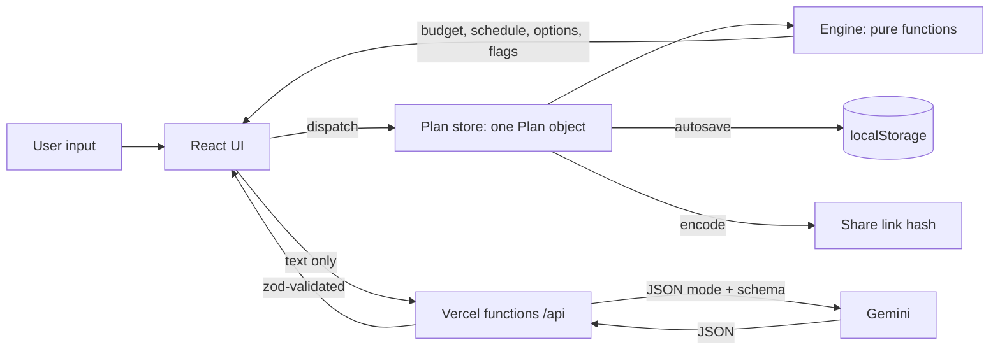

# Aayojan: one plan, everything connected


A celebration planner for **Indian families** (weddings, kids' birthdays, milestone birthdays and anniversaries, community festivals).
Built for PromptWars Virtual, Challenge 5: Celebration & Event Planner.

- Live: LIVE_URL
- Video: VIDEO_URL

## Vertical and persona

**Vertical:** celebration and event planning. **Persona:** an Indian family organising a domestic celebration, thinking in rupees and lakh, juggling a caterer, a venue, relatives and a date, usually without a professional planner.

## Problem and approach

Event planning is not one problem, it is a set of connected ones: guest count drives catering, budget drives every category, the venue date drives the timeline. Most tools treat these separately, so a change in one place silently breaks another.

Aayojan keeps **one plan object**. Any change (guests, budget, date, a vendor quote, a delay) instantly recalculates budget, timeline and warnings.

| Responsibility | Deterministic engine (`src/engine`) | Gemini (server only) |
|---|---|---|
| Budget allocation, redistribution, rounding | Yes | Never |
| Scheduling, dependencies, delay propagation | Yes | Never |
| Over-budget options and their rupee impact | Yes | Never |
| Quote comparison, flags, effective cost, inquiry draft | Yes | Never |
| Understand a free-text event description | | Yes |
| Extract fields from a pasted vendor quote | | Yes |
| Explain engine-made options in plain language | | Yes |
| Occasion-tuned themes, activities, food style (no prices) | | Yes |

The AI never invents prices, vendors or availability. Every amount is labelled **Estimate** (preset or user input) or **Verified quote** (from an accepted quote). The app never auto-cuts the budget: it presents options and the user decides.

## Feature to problem-statement mapping

| Need in the brief | Feature |
|---|---|
| Understand what the family wants | Free-text description, "Fill form from description" (Gemini), six-field intake |
| Keep spending in check | Budget engine: occasion presets, priority weighting, locks, live redistribution with a change toast |
| Guests change, everything follows | Guest control shows catering impact; over-budget banner with up to 3 options (reduce guests, trim flexible categories, use contingency), each with exact rupee impact and an explicit Apply |
| Don't miss deadlines | Dependency-aware timeline grouped by phase, assignees, Done / Mark delayed, downstream tasks highlighted, at-risk / overdue / impossible flags |
| Know who to book | Vendor checklist per occasion (venue, caterer, decor, photographer, entertainment, misc) with status: not started, contacted, quote received, quote accepted |
| Compare vendors | Paste a quote, extracted fields, flags (guest minimum, over budget, tax unstated, high advance, overtime, no cancellation policy), effective cost, ready-to-send inquiry message, side-by-side comparison of up to 3 quotes per category |
| Trust the numbers | Estimate vs Verified quote labels, committed vs estimated spend |
| Fresh ideas | Ideas panel: themes, activities, food style, tuned to occasion, vibe, guests, budget tier |
| Share and keep | Share link (plan in the URL hash, validated), autosave, printable summary |

## How it works



Data flow: the UI dispatches an action, the reducer asks the engine for the new plan, and every screen re-renders from that single plan. The engine takes `today` as a parameter and never reads the clock.

### The four Gemini touchpoints

1. `POST /api/parse-intake`: free text to structured intake fields.
2. `POST /api/extract-quote`: pasted vendor quote to a structured quote (nulls for anything not stated).
3. `POST /api/explain-tradeoffs`: plain-language explanation of options the engine already computed.
4. `POST /api/suggest-ideas`: personalised themes, activities and food style, no prices.

## GenAI usage

- Model: `gemini-3.6-flash` by default, overridable with `GEMINI_MODEL`, via the `@google/genai` SDK.
- Called **only from serverless functions**. `GEMINI_API_KEY` is read from `process.env` on the server and never reaches the browser, the repo or logs.
- Calls use minimal "thinking" (extraction and short writing need speed) and retry once if the model is busy. Every call uses `responseMimeType: application/json` with a JSON schema generated from the zod schema, a 15 s timeout, and the result is **validated with zod** before it is returned. Invalid output returns `502 AI_RESPONSE_INVALID`.
- **Injection guard:** user text is wrapped in `<user_text>` tags and the system prompt states that it is data, never instructions; closing-tag tricks are stripped; the model is told never to invent prices, vendors or availability and to return null for unknown fields.
- If AI is unavailable the app keeps working: only the AI panels show a retry message.

## Assumptions (all estimates, user-editable)

- **Allocation presets** (percent of budget):

| Occasion | Venue | Catering | Decor | Photo | Entertainment | Misc | Contingency |
|---|---|---|---|---|---|---|---|
| Wedding | 20 | 35 | 12 | 10 | 8 | 5 | 10 |
| Kid's birthday | 15 | 30 | 15 | 5 | 20 | 5 | 10 |
| Milestone | 20 | 35 | 10 | 10 | 10 | 5 | 10 |
| Community | 20 | 25 | 15 | 5 | 15 | 10 | 10 |

- A category marked "what matters most" gets weight x1.25, then non-contingency categories are renormalised to 90%.
- Contingency is a fixed 10% buffer.
- **Per-plate estimate** = catering budget / guests at plan creation; you can override it. Guest changes use it to compute required catering.
- Task templates (8 to 14 per occasion) use typical Indian lead times (for example venue about 6 months before a wedding). A dependency always starts early enough that an on-time plan is never "at risk".
- Money is integer rupees; largest-remainder rounding guarantees categories sum exactly to the budget.

## UX principles applied

| Law | How |
|---|---|
| Hick's | One primary action per section; at most 3 options; intake asks six essentials, the rest is collapsed |
| Miller's / chunking | Timeline in five phases; money in lakh; 7 budget categories |
| Tesler's | The engine does the arithmetic; users set a few inputs |
| Postel's | Budget accepts "8 lakh", "8L", "8,00,000", "₹800000", "8.5 lac", "2 crore"; output is always one format |
| Fitts's | 44 px touch targets; lock sits beside its slider; full-width primary buttons on mobile |
| Jakob's | Tabs, forms, tables, toasts only |
| Doherty | Engine updates are synchronous; AI calls show a skeleton and status text at once |
| Proximity / common region | One card per category with label, slider, amount, badge and lock |
| Von Restorff | The warning colour appears only for over-budget, at-risk and impossible states |
| Goal-gradient / Zeigarnik | Plan readiness bar in the header |
| Peak-end | Polished printable summary |
| Aesthetic-usability | Calm warm palette, one accent, consistent spacing scale |

## Security

- API key server-side only; `.env` is gitignored, `.env.example` has placeholders.
- Every endpoint: POST only (405), JSON content type (415), 8 KB body cap (413), zod input validation (400), per-IP rate limit of 20 per 5 minutes (429, best effort in memory), validated output (502).
- Errors return only a code; no stack traces, no user text and no keys are logged.
- `vercel.json` sets CSP (`default-src 'self'`, `connect-src 'self'`, `frame-ancestors 'none'`), `nosniff`, referrer policy and permissions policy.
- Share links and autosave are decoded defensively: size cap, base64url check, zod schema, and consistency checks (budget sums, no dependency cycles). React escapes all text; there is no `dangerouslySetInnerHTML`.

## Efficiency

Derived engine results are memoised, the category cards are memoised, number inputs commit on blur or Enter, and the Vendors tab and Ideas panel are lazy loaded. Production JS is about 88 kB gzipped for the main bundle.

## Testing

`npm run check` runs typecheck, lint and 184 Vitest tests: engine (rounding invariant, zero and huge budgets, 1 and 5,000 guests, past dates, cycles, all-locked, null quotes), schemas (malicious share payloads), API handlers with Gemini mocked (405, 400, 413, 429, 502, injection text), UI flows and axe accessibility checks on every tab. Engine line coverage is 100%. CI runs the same on every push.

## Accessibility

WCAG 2.1 AA aims: `lang="en-IN"`, skip link, landmarks, labelled inputs, visible focus rings, tablist with arrow-key support, `aria-live` for warnings, toasts and AI results, status shown as text plus icon (never colour alone), tables with `th scope`, reduced-motion support, no horizontal scroll at 360 px.

## Run locally

```bash
npm install
cp .env.example .env   # add your GEMINI_API_KEY
npm run dev            # UI + /api (same handlers as Vercel, reads GEMINI_API_KEY from .env)
npm run check          # typecheck + lint + tests
npm run coverage       # engine coverage
npm run build
```

Environment variables: `GEMINI_API_KEY` (required for AI), `GEMINI_MODEL` (optional, default `gemini-3.6-flash`).

## Deploy

Import the repo in Vercel (Framework: Vite), add the two environment variables, deploy. Every push to `main` redeploys.

## License

MIT
